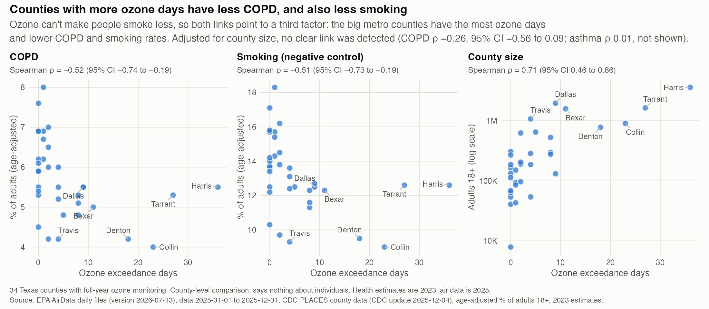
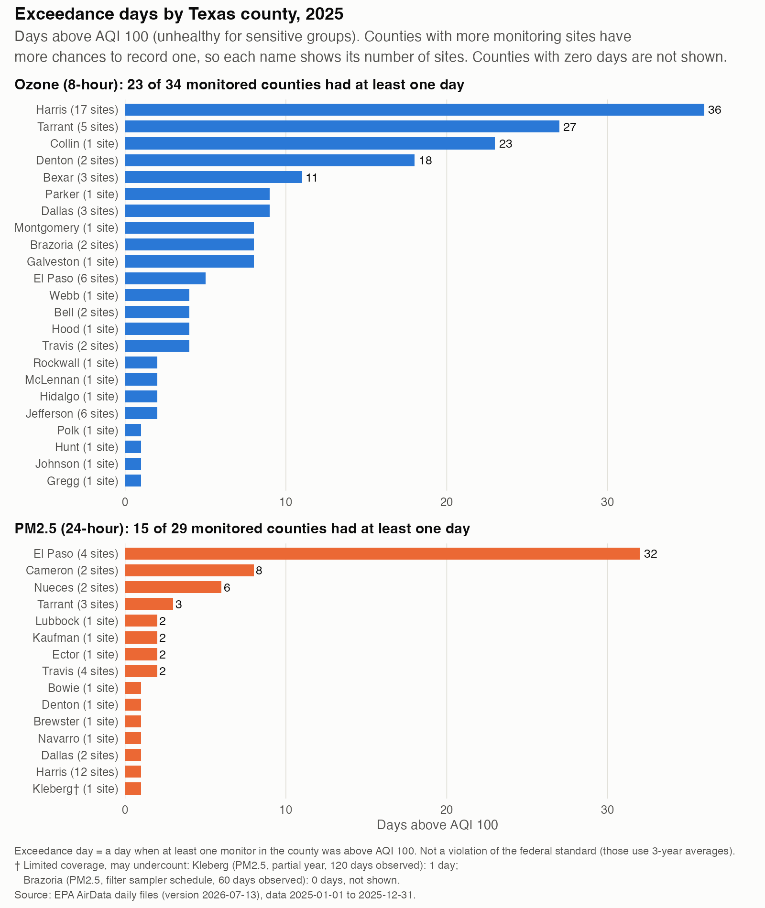
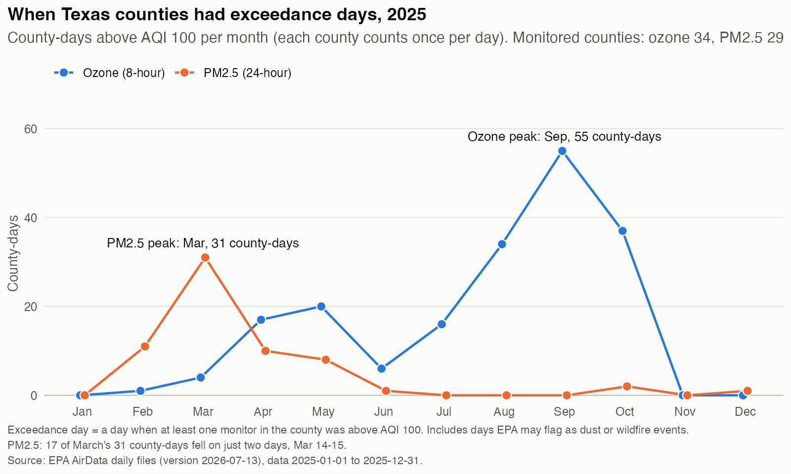

# Texas Air Quality 2025

Which Texas counties had the most days above AQI 100 for ozone and PM2.5 in 2025, and do those counties also have higher adult asthma or COPD rates?

Harris, Tarrant, Collin and Denton had the most ozone days, and El Paso had the most PM2.5 days. The health side surprised me: counties with more ozone days had *lower* COPD rates. They also had lower smoking rates, which ozone can't explain, so the pattern says more about how big metro counties differ from small ones than about ozone. Once I adjusted for county population, the COPD link weakened to ρ = −0.26 and its confidence interval included zero.

Tools: R (tidyverse: readr, dplyr, tidyr; ggplot2 + patchwork for figures) · RStudio · Git/GitHub · Tableau Public ([interactive county map](https://public.tableau.com/app/profile/abdul.zarbi/viz/texas_air_quality_map_2025/Dashboard1))



## Key findings

Air data: EPA AirData daily files, all Texas monitors, 2025-01-01 to 2025-12-31 (file version 2026-07-13). An **exceedance day** is a day when at least one monitor in the county was above AQI 100 (PM2.5 ≥ 35.5 µg/m³ 24-hour average, ozone ≥ 0.071 ppm 8-hour average). 42 of Texas's 254 counties had a PM2.5 or ozone monitor reporting in 2025: 34 for ozone, 29 for PM2.5.

1. **Ozone was the wider problem.** 23 of 34 ozone-monitored counties had at least one exceedance day: 190 county-days in total, spread over 70 calendar days. Harris led with 36 days (17 monitoring sites), then Tarrant 27, Collin 23 and Denton 18. Collin reached 23 days with a single site.
2. **PM2.5 was concentrated in El Paso.** 15 of 29 PM2.5-monitored counties had at least one day, but El Paso alone had 32 of the 64 county-days. Its highest daily value was 288.5 µg/m³ on 2025-04-01, eight times the 24-hour standard.
3. **The two pollutants peak in different seasons.** Two-thirds of ozone county-days (126 of 190) fell in August–October, with September the worst month (55 county-days in 13 counties). PM2.5 peaked in February–April (52 of 64). In March, 17 of the 31 PM2.5 county-days came from just two days, March 14–15.
4. **Counties with more ozone days had lower COPD rates, and that looks like confounding.** Across the 34 ozone counties, more ozone days went with lower adult COPD (Spearman ρ = −0.52, 95% CI −0.74 to −0.19) and lower smoking (ρ = −0.51, −0.73 to −0.19). Ozone can't make people smoke less, so smoking works as a negative control here: at least part of both links must come from a shared factor. County population is the likely one. Ozone days track adult population (ρ = 0.71), and the large metro counties have lower COPD and smoking rates. Adjusted for adult population, the COPD link weakened to ρ = −0.26 (−0.56 to 0.09). Adjusting for the number of monitoring sites instead did not remove it (ρ = −0.46, −0.70 to −0.12), so it's population, not monitor count, that matters here. Asthma showed a weaker version of the pattern (ρ = −0.37, not significant after multiple-testing correction, q = 0.14) that disappeared after adjustment (0.01). No clear association was detected.
5. **PM2.5 showed no clear link to asthma or COPD** (27 counties with near-full-year coverage, at least 274 observed days). Every confidence interval included zero, before and after adjustment.

| Ranked counties | Monthly pattern |
|---|---|
|  |  |

**Interactive map:** [all 254 Texas counties on Tableau Public](https://public.tableau.com/app/profile/abdul.zarbi/viz/texas_air_quality_map_2025/Dashboard1). Switch between ozone and PM2.5 and hover over a county for its days, sites, highest reading and COPD/asthma rates. Counties shown in gray had no monitor; that means they weren't measured, not that their air was clean.

## Recommendation

Don't read a county's exceedance count as a health-risk ranking. The counts depend partly on how many monitors a county has (one monitor over AQI 100 is enough). And the counties with the most ozone days are the big metros, which also differ from smaller counties in population, smoking and COPD rates. To test whether ozone or PM2.5 harms health in Texas, compare **days within the same county** (for example, daily asthma ER visits against that day's air quality) instead of comparing counties with each other. For alerts, timing is the practical takeaway from 2025: ozone days clustered in August–October around Houston and Dallas–Fort Worth, and PM2.5 days in February–April, with El Paso the hardest-hit county.

## Data

| Data | Source | Version | License |
|---|---|---|---|
| Daily PM2.5 (88101) and ozone (44201), all US monitors, 2025 | [EPA AirData pre-generated files](https://aqs.epa.gov/aqsweb/airdata/download_files.html) | Last modified 2026-07-13, data through 2025-12-31 | U.S. government work, public domain |
| Adult asthma, COPD and smoking prevalence by county | [CDC PLACES County Data, 2025 release](https://data.cdc.gov/d/swc5-untb) | 2023 model-based estimates, CDC update 2025-12-04 | Public domain |

What each download contained (rows, counties, checksums) is recorded in `data/raw/download_manifest.csv` and `data/raw/places_manifest.csv`. The large EPA files are re-downloaded by `scripts/01_download.R` into `data/raw/large/`, which is gitignored. `data/raw/ad_viz_plotval_data.csv` is a single-site file from the project setup and isn't used by the scripts.

## Method

| Step | Script | What it does |
|---|---|---|
| 1 | `01_download.R` | Downloads the EPA daily files, keeps Texas, checks the file and writes a manifest |
| 2 | `02_clean.R` | One row per monitor per day. PM2.5 = 24-hour average; ozone = daily maximum 8-hour average. Flags AQI > 100 and checks the flag against EPA's own AQI column (0 mismatches) |
| 3 | `03_analysis.R` | Collapses monitors to county-days (a county counts once per day) and builds county and monthly tables. Flags counties with under 274 observed days |
| 4 | `04_download_places.R` | Downloads CDC PLACES for Texas (asthma, COPD, smoking; age-adjusted and crude) |
| 5 | `05_health_compare.R` | Joins air to health by county FIPS code. Spearman correlation with 95% CI, p-values, Benjamini–Hochberg correction, and partial correlations adjusted for smoking or adult population |
| 6 | `06_figures.R` | The three figures in this README |
| 7 | `07_tableau_export.R` | One row per county and pollutant for all 254 counties (counties without a monitor are marked, not set to 0) for the Tableau map |

Each script stops with an error if a check fails (duplicate rows, missing values, unexpected counts). The headline numbers were also recomputed a second way in base R.

A few choices that affect the numbers:

- Wildfire and dust days are included. EPA can set these "exceptional event" days aside for regulatory purposes, but people still breathed that air. (In the 2026-07-13 file, no 2025 Texas day had been flagged yet.)
- Two counties with limited coverage are kept in the tables and flagged, but left out of the health comparison: Kleberg (its PM2.5 monitor stopped in May) and Brazoria (its PM2.5 filter sampler runs every 6th day).
- Health rates are age-adjusted, so a county with older residents doesn't look sicker just because of its age mix.

## Limitations

- An exceedance day is not a violation. Federal compliance uses 3-year averages ("design values"); this project counts single days above AQI 100.
- 212 of Texas's 254 counties have no PM2.5 or ozone monitor, so the results say nothing about them.
- This compares counties, not people. A county-level pattern doesn't tell you what happens to any individual (the ecological fallacy).
- The health estimates are for 2023 and the air data is for 2025.
- CDC PLACES values are modeled from survey data and demographics, not counted cases, and they cover adults only. Children, the group most sensitive to ozone, aren't included.
- With 27–34 counties, a modest real effect could easily go undetected. "No clear association detected" is not the same as "no association".

## How to reproduce

1. Clone the repo and open `Texas_Air_Polution2025.Rproj` in RStudio. Tested with R 4.4.1 and dplyr 1.1.4 (needs R 4.1+ and dplyr 1.1+).
2. Install the packages once:
   ```r
   install.packages(c("readr", "dplyr", "tidyr", "purrr", "ggplot2", "patchwork",
                      "ggrepel", "ragg", "scales", "jsonlite"))
   ```
3. Open each script in `scripts/` in order (01 to 07) and click **Source**. Scripts 01 and 04 download data from EPA and CDC, so they need an internet connection. They fetch whatever version EPA and CDC publish that day; compare the checksums in the two manifest files to see whether your data matches the version used here.

Outputs land in `data/clean/`, `output/tables/` and `output/figures/`. To rebuild the map, open `tableau/texas_air_quality_map_2025.twbx` in Tableau Public; it was built from `output/tables/tableau_county_map_2025.csv`.

## Repository layout

```
data/raw/        original downloads + manifests (large EPA files gitignored)
data/clean/      tidy daily tables from 02_clean.R
scripts/         numbered R steps, 01 to 07
output/tables/   county, monthly, correlation and map tables (every number above)
output/figures/  README figures
tableau/         Tableau Public workbook for the county map
reports/         Quarto write-up (planned)
```

## Status

- [x] Download, clean and analyze all Texas PM2.5 and ozone monitors for 2025
- [x] Add CDC PLACES county health estimates and compare
- [x] Figures and findings
- [x] Tableau Public map

## License

Code: [MIT](LICENSE). EPA and CDC data: U.S. government works, public domain.
